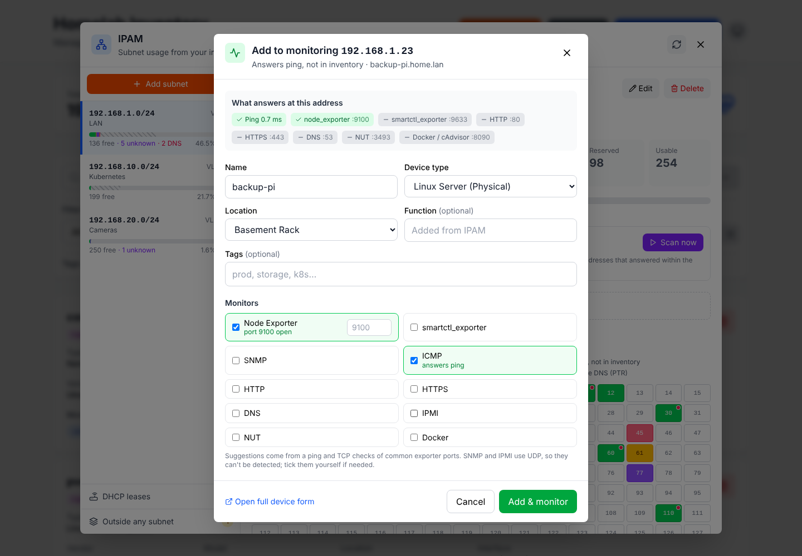

# Homelab Inventory

A self-hosted inventory for your homelab. Track every device, what it runs on, and what powers it. It also shows which IP addresses are really free, feeds Prometheus directly, and pushes your inventory into Ansible, NetBox, or anything that accepts a webhook.

Built with React and Flask, stored in SQLite, shipped as two Docker images.


<picture>
  <source media="(prefers-color-scheme: dark)" srcset="screenshots/dark/dashboard.png">
  
</picture>

> **New in 2.1:**
> - **Add to monitoring from IPAM.** Click an address that's on the network but not in inventory. The app probes it, picks matching monitors, and adds it in one step.
> - **Reverse DNS checks** in every ping sweep, shown with a new color in the address grid.
> - **Tailwind CSS 4** in the frontend.
>
> Upgrading? See [Upgrading](#upgrading). Full details are in the [changelog](CHANGELOG.md).

## Contents

- [Features](#features)
- [Quick start](#quick-start)
- [Configuration](#configuration)
- [Using Homelab Inventory](#using-homelab-inventory)
- [API reference](#api-reference)
- [Upgrading](#upgrading)
- [Backups](#backups)
- [Security](#security)
- [Development](#development)
- [Troubleshooting](#troubleshooting)
- [Roadmap](#roadmap)

## Features

**Inventory**
- Thirteen device types: Linux servers (physical and virtual), FreeBSD servers, switches, wireless APs, IP cameras, video streamers, IoT devices, IPMI consoles, UPSes (NUT), URLs, DNS records, and ICMP-only devices.
- Each device records:
  - address (IP, hostname or URL), function, vendor, model, location and serial number
  - networks (LAN, IoT, DMZ, GUEST, ALL)
  - interface types, from 10Base-T to 400G and Wi-Fi 4–7
  - PoE details
- Free-form **tags** with autocomplete and click-to-filter.
- **Relationships**: *runs on* (VM → host), *connected to* (→ switch, with port), and *powered by* (→ UPS or PDU, with outlet).
- **Impact analysis** shows everything that goes down with a device.
- **History**: a field-level change log for every device, plus a global history across the inventory.
- **Search**: quick search across many fields, plus advanced filters (type, vendor, model, location, monitoring, PoE, IP).
- Clone devices, and import or export them in bulk as JSON or CSV.

**IPAM**
- IPv4 and IPv6 subnets in CIDR form, with VLAN, gateway, location, and reserved ranges (DHCP pools, VIPs).
- A color-coded address grid, utilization bars, free ranges, and **next free IP**.
- **Ping sweeps** (scheduled or on demand) find addresses that answer but aren't in your inventory.
- Each sweep also checks **reverse DNS**, flagging stale PTR records and devices with no record.
- **dnsmasq DHCP leases** from a watched file, a `curl` push, or an upload.
- **Add to monitoring**: probe an unknown address and add it, with monitors, in one step.
- Flags duplicate IPs and devices outside every subnet.

**Monitoring**
- Ten monitor types: node_exporter, smartctl_exporter, SNMP, ICMP, HTTP, HTTPS, DNS, IPMI, NUT, and Docker.
- **Prometheus HTTP service discovery**, with a generated `scrape_configs` block. File-based export is also available.
- **Live status** read from your Prometheus: Up, Down, Degraded, or Not scraped on every device.

**Integrations**
- **Ansible** dynamic inventory: a dependency-free script or a static YAML file.
- **NetBox** CSV bulk-import bundle.
- **Webhooks** for device and IPAM events, with HMAC signatures and retries.

**Interface**
- Responsive React UI with light, dark, and auto themes.
- Mobile-friendly: large touch targets and safe-area support.
- Full and condensed list views.

### Screenshots

Full galleries: [light theme](screenshots/light/README.md) · [dark theme](screenshots/dark/README.md)

| IPAM | Add to monitoring | Relationships and impact |
|---|---|---|
|  |  |  |

## Quick start

You need Docker with Compose v2. The images are published to GitHub Container Registry, so nothing is built locally.

```bash
git clone https://github.com/pyrodex/homelab-inventory.git
cd homelab-inventory
cp docker-compose.yaml.example docker-compose.yaml   # edit to taste
docker compose up -d
```

Open **http://localhost:5000**. The optional sqlite-web database browser is at http://localhost:5001.

The stack has three services:

| Service | Image | Purpose |
|---|---|---|
| `frontend` | `ghcr.io/pyrodex/homelab-inventory/frontend` | nginx serving the UI on port 80 (published as 5000) and proxying `/api` to the backend |
| `backend` | `ghcr.io/pyrodex/homelab-inventory/backend` | Flask API on port 5000, internal only |
| `sqlite-web` | `coleifer/sqlite-web` | Optional raw database browser. It has **no authentication**, so remove it if you don't need it |

Data lives in `./data` (the SQLite database and backups) and `./targets` (Prometheus file exports). Both are created on first start.

**Image tags:**

| Tag | What it is |
|---|---|
| `latest` | The current `main` branch |
| `2.1.0` | An exact release |
| `2.1` or `2` | Latest patch, or latest minor, within that line |

To stay on a release line, pin it in `docker-compose.yaml`, e.g. `ghcr.io/pyrodex/homelab-inventory/backend:2`.

## Configuration

All configuration is through environment variables on the **backend** service. Everything optional is off or empty until you set it.

### Core

| Variable | Default | Description |
|---|---|---|
| `DATABASE_PATH` | `homelab.db` (`/app/data/homelab.db` in the example compose file) | SQLite database file; created if missing |
| `PROMETHEUS_EXPORT_PATH` | `/app/prometheus_targets` | Where **Write Prometheus** puts file-SD target files |
| `FLASK_ENV` | `production` | `development` enables debug mode and verbose logging |
| `AUTO_MIGRATE` | `true` | Apply database migrations on startup. In production a failed migration stops startup |
| `CORS_ORIGINS` | `*` | Comma-separated allowed origins. The bundled frontend uses the same origin, so you rarely need this |
| `RATELIMIT_STORAGE_URL` | `memory://` | Rate-limit storage; use Redis or Memcached if you run several backend processes |
| `SECRET_KEY` | `dev-secret-key-change-in-production` | Flask secret. Nothing relies on it today, but set it anyway; production logs a warning if it's the default |
| `LOG_LEVEL` | `INFO` | `DEBUG`, `INFO`, `WARNING`, or `ERROR` |

### Prometheus

| Variable | Default | Description |
|---|---|---|
| `PROMETHEUS_URL` | — | Your Prometheus, e.g. `http://prometheus:9090`. Enables live device status |
| `PROMETHEUS_BEARER_TOKEN` | — | Bearer token sent to `PROMETHEUS_URL` |
| `PROMETHEUS_USERNAME` / `PROMETHEUS_PASSWORD` | — | Basic auth for `PROMETHEUS_URL`, used if no bearer token is set |
| `PROMETHEUS_VERIFY_TLS` | `true` | Verify TLS for an `https://` Prometheus |
| `PROMETHEUS_STATUS_CACHE_SECONDS` | `15` | How long status query results are cached |
| `PROMETHEUS_TIMEOUT_SECONDS` | `5` | Timeout for each status query |
| `PROMETHEUS_SD_TOKEN` | — | If set, `/api/prometheus/sd` requires `Authorization: Bearer <token>` |

### IPAM

| Variable | Default | Description |
|---|---|---|
| `IPAM_BACKGROUND_WORKERS` | `true` | Run the ping-sweep scheduler and the lease-file watcher |
| `IPAM_SCAN_MAX_HOSTS` | `1024` | Largest subnet, in usable hosts, that may be swept |
| `IPAM_STALE_AFTER_HOURS` | `72` | How long an address that answered a ping still counts as in use |
| `IPAM_SWEEP_PTR` | `true` | Look up reverse DNS for every swept address. `false` checks only addresses that answer |
| `IPAM_PTR_BLOCKS_FREE` | `true` | Keep addresses whose only evidence is a PTR record out of free and next-free |
| `DNSMASQ_LEASES_PATH` | — | Comma-separated dnsmasq lease files to watch. Mount them into the container |
| `DNSMASQ_LEASES_POLL_SECONDS` | `60` | How often watched lease files are checked for changes |
| `IPAM_LEASES_TOKEN` | — | If set, lease uploads require `Authorization: Bearer <token>` |

### Backups

| Variable | Default | Description |
|---|---|---|
| `BACKUP_DIRECTORY` | `/app/data/backups` | Where backups are written |
| `BACKUP_RETENTION_DAYS` | `30` | Backups older than this are deleted |
| `BACKUP_SCHEDULE` | `0 2 * * *` | Cron schedule for the backup job inside the container, read at container start |

The backend also checks its paths at startup. It creates missing directories and logs warnings for risky settings, such as the default `SECRET_KEY` or `CORS_ORIGINS=*` in production.

## Using Homelab Inventory

The header has **Add Device**, **Admin**, and **Other Actions**. Other Actions opens:
- Write Prometheus / Download Config
- Prometheus SD & Status
- Bulk Ops
- Export (Ansible / NetBox)
- History
- Discover
- IPAM / Subnets

On mobile, everything is under the **Actions** menu.

### Devices

- **Add a device** with **Add Device**.
  - The form asks for name, type, address, function, vendor, model, location, and serial number.
  - Devices added from Discovery, or from an address IPAM has seen on the network, skip vendor, model, location, and serial.
  - The API itself requires only `name` and `device_type`.
- **Monitors**: add one or more per device. Leave the port blank to use the default:

  | node_exporter | smartctl_exporter | SNMP | HTTP | HTTPS | DNS | IPMI | NUT | Docker |
  |---|---|---|---|---|---|---|---|---|
  | 9100 | 9633 | 161 | 80 | 443 | 53 | 623 | 3493 | 8090 |

  ICMP has no port. An HTTP or HTTPS monitor can also take a full endpoint URL.
- **Card actions**: toggle monitoring, clone, edit, and delete (with confirmation).
- **History**:
  - The device form's **History** section shows field-level diffs.
  - **Other Actions → History** shows changes across all devices, 50 to 500 per page or all at once.
- **Admin** manages vendors, models (filtered by vendor), locations, tags, and webhooks.

### Search, filters, and tags

- The search box matches name, IP, function, serial number, networks, interface types, and PoE standards.
- **Filters** adds type, vendor, model, location, monitoring status, PoE, and has-IP filters. Active filters show as removable chips.
- **Tags**:
  - In the device form, type a tag and press Enter or comma. Tags become lowercase slugs (`Home Lab` → `home-lab`).
  - Click a tag on a card or in the tag bar to filter. Several tags must all match.
  - Rename, merge, or delete tags under **Admin → Tags**.

### Relationships and impact

In the device form's **Relationships** section, pick a type and a device:

| Type | Meaning | Detail |
|---|---|---|
| Runs on | VM or container → host | One host per device |
| Connected to | Device → switch or AP | Optional port |
| Powered by | Device → UPS, PDU, or PoE switch | Optional outlet |

Loops are rejected. Every device shows *"If this goes down, N devices are affected"*, with the full dependency tree.

### Discovery

**Other Actions → Discover** probes:
- single IPs or hostnames
- a dashed range (`192.168.1.10-192.168.1.20`)
- a CIDR block (`192.168.1.0/28`)

Up to 256 targets are probed in parallel. Each result shows reachability, round-trip time, and reverse DNS, with **Add Device** to save it straight from the list.

### IPAM

Open **Other Actions → IPAM / Subnets** and click **Add subnet**. Enter a CIDR (e.g. `192.168.10.0/24`) and, optionally:
- name, VLAN, and gateway
- location (devices added from IPAM inherit it)
- description
- reserved ranges such as a DHCP pool (`192.168.10.100-199`)

Usage is computed live from device IPs and monitor endpoints, so there's nothing to keep in sync. The address grid uses these colors:

| Color | Meaning | Counts as free? |
|---|---|---|
| Green | In inventory and monitored | No |
| Amber | In inventory, monitoring off | No |
| Violet | Answered a ping sweep, not in inventory | No |
| Cyan | Active DHCP lease, not in inventory | No |
| Rose | Has a PTR record, nothing else claims it | No, unless `IPAM_PTR_BLOCKS_FREE=false` |
| Blue | Gateway | No |
| Striped | Reserved range | No |
| Dark | Network or broadcast address | No |
| White | Free | Yes |

A small rose dot marks any address with a PTR record.

**Using the grid**
- Click a free address, or **Next free**, to copy it or add a device there with the IP and location filled in.
- **In use** lists inventoried addresses with their PTR names, and flags devices with **no PTR**.
- **Outside any subnet** lists devices whose IP isn't covered by a subnet.
- Subnets over 4,096 addresses skip the grid and show compressed free ranges.
- Devices addressed by hostname aren't counted, since their IP isn't known.

**Ping sweeps**
- Tick **Ping sweep** on a subnet and pick an interval (5 minutes to 7 days), or click **Scan now**.
- Sweeps are IPv4-only, limited to `IPAM_SCAN_MAX_HOSTS`, and ping in parallel. A /24 takes about a second.
- Every sweep also looks up the PTR record for each address, using the backend's resolver.
- A resolver failure never erases a name already recorded. Only a definite "no record" clears it.

**DHCP leases (dnsmasq)** can come in three ways:
- **Watched file:** mount the lease file and set `DNSMASQ_LEASES_PATH=/leases/dnsmasq.leases`. It's re-read whenever it changes.
- **Push** from the dnsmasq host, e.g. with cron:

  ```bash
  curl -fsS --data-binary @/var/lib/misc/dnsmasq.leases \
    "http://homelab-inventory:5000/api/ipam/dhcp/leases?source=pihole"
  ```
- **Upload or paste** under **IPAM → DHCP leases**.

Each source is a snapshot: leases missing from its next import are released, and expired leases stop counting automatically.

**Not in inventory** lists every violet, cyan, or rose address with its evidence: ping time, lease, hostname, MAC, and PTR. **Add** opens the full device form, filled in.

**Add to monitoring** works on any violet, cyan, rose, or amber address. Click it in the grid, in **Not in inventory**, or on an amber **In use** row.
- **Probing**:
  - The window pings the address and tries TCP connections to 9100, 9633, 80, 443, 53, 3493, and 8090.
  - Monitors for whatever answers are pre-selected, with the reason shown.
  - SNMP and IPMI use UDP and can't be detected this way; tick them yourself.
- **Not in inventory**:
  - The name comes from the DHCP or PTR hostname, and the location from the subnet.
  - The device type comes from what answered: NUT means a UPS, node_exporter means a Linux server.
  - **Add & monitor** creates the device and its monitors in one step.
- **Monitoring off**: **Turn on monitoring** enables the device and adds any monitors you ticked.
- **Safety and side effects**:
  - Only addresses inside a defined subnet can be probed, so this can't be used to scan arbitrary hosts.
  - Changes appear in device history and fire webhooks like any other edit.

### Prometheus

**HTTP service discovery (recommended).** Prometheus pulls targets from the app, so edits apply on its next refresh. You don't need file exports or reloads. **Other Actions → Prometheus SD & Status** generates a ready-to-paste `scrape_configs` block, including blackbox and SNMP exporter relabeling. Or write one by hand:

```yaml
scrape_configs:
  - job_name: inventory_linux_node_exporter
    http_sd_configs:
      - url: http://homelab-inventory:5000/api/prometheus/sd?group=linux_node_exporter
        refresh_interval: 60s
        # authorization:
        #   credentials: <PROMETHEUS_SD_TOKEN>
```

**Groups** follow the monitor type: `linux_node_exporter`, `freebsd_node_exporter`, `node_exporter`, `smartctl_exporter`, `snmp`, `icmp`, `http`, `https`, `dns`, `ipmi`, `nut`, and `docker`.

**Target labels:**
- device fields: `device_name`, `device_type`, `ip_address`, `deviceFunction`, `networks`, `vendor`, `model`, `location`, `serial_number`, `interface_type`, `poe_powered`, `poe_standards`
- monitor fields: `monitor_type`, `monitor_endpoint`
- inventory links: `inventory_device_id`, `tags`, `runs_on`
- service discovery also adds `inventory_group`

`tags` is written as `,prod,web,`, so `tags=~".*,prod,.*"` matches exactly one tag. Devices without an IP and disabled monitors are skipped.

**Live status.** Set `PROMETHEUS_URL` and each device shows **Up**, **Down**, **Degraded**, or **Not scraped**, with a Prometheus card in the stats row.
- **How series are read:** `probe_success` (blackbox probes) and `up` (exporters).
- **How series are matched to devices:**
  1. `inventory_device_id` + `monitor_type`
  2. `device_name` + `monitor_type`
  3. `instance` address, so hand-written jobs still match
- Status refreshes every 60 seconds. If Prometheus is unreachable, the badges hide rather than show stale data.

**File-based discovery.** **Write Prometheus** writes one YAML file per device into `PROMETHEUS_EXPORT_PATH/<group>/`. **Download Config** gives the same files as a ZIP.

```yaml
scrape_configs:
  - job_name: linux_node_exporter
    file_sd_configs:
      - files: ['/path/to/targets/linux_node_exporter/*.yaml']
```

### Ansible and NetBox

Open **Other Actions → Export (Ansible / NetBox)**. Tag and monitoring filters apply to both.

- **Ansible**:
  - Copy the setup commands shown (they download the inventory script from your instance), or download a static YAML inventory.
  - Hostnames stay the same whatever filters you use.
  - Groups and host variables are documented in [contrib/ansible](contrib/ansible/README.md).
- **NetBox**:
  - Download the ZIP and import the CSVs in numbered order.
  - Locations become sites and device types become roles.
  - VMs attach to their *runs on* host.
  - IPs take their subnet's prefix length.

### Webhooks

**Admin → Webhooks → Add webhook**: give it a URL and pick events. A signing secret is generated by default and shown **once**. **Test** sends a `ping`.

| Event | When |
|---|---|
| `device.created` | A device is added (UI, API, bulk import, or IPAM) |
| `device.updated` | A tracked field or tag changes, including tag renames |
| `device.deleted` | A device is removed (single or bulk) |
| `device.relationship_changed` | A runs on, connected to, or powered by link is added, edited, or removed |
| `ipam.address_discovered` | A ping sweep or DHCP lease reports a new address that isn't in inventory |

**Payload:** `{id, event, occurred_at, source, device, changes, summary, change_type}`. For `ipam.address_discovered`, `address`, `subnet`, and `discovered_by` replace the device fields.

**Delivery:**
- Events fire only after the change is committed.
- Deliveries time out after 5 seconds and don't follow redirects.
- On 5xx, 408, 429, or connection errors, they retry after 10 s and again after 60 s.
- Queued deliveries don't survive a restart.
- Each webhook's delivery log shows its last 50 attempts.

Verify the signature (Python):

```python
import hashlib, hmac
expected = "sha256=" + hmac.new(SECRET.encode(), request_body_bytes, hashlib.sha256).hexdigest()
assert hmac.compare_digest(expected, headers["X-Hub-Signature-256"])
```

### Bulk import, export, and delete

**Other Actions → Bulk Ops**:
- **Import** a JSON array of device objects (same fields as the API) or a CSV file.
  - CSV columns: `name`, `device_type`, `ip_address`, `deviceFunction`, `vendor`, `model`, `location`, `serial_number`, `networks`, `interface_type`, `poe_powered`, `poe_standards`, `monitoring_enabled`, `tags`.
  - Vendor, model, and location are matched by name and must already exist.
  - Monitors aren't imported; add them afterwards.
  - Each row succeeds or fails on its own, and the result lists the errors.
- **Export** all devices, or one type, as JSON or CSV. The CSV includes tags and timestamps.
- **Delete** up to 100 devices at once by ID.

## API reference

All endpoints are under `/api`. In the Docker stack, reach them through the frontend (`http://<host>:5000/api/...`).

> **Response shapes.**
> - Device, discovery, relationship, and tag endpoints wrap results as `{"success": true, "data": ..., "message": ...}`. Their errors look like `{"success": false, "error": ..., "details": {...}, "error_code": ...}`.
> - Other endpoints return the object directly, with errors as `{"error": ..., "details": {...}}`.
> - Validation errors are `400`, and rate-limit errors are `429`.

### Devices and monitors

| Method | Path | Notes |
|---|---|---|
| GET | `/devices` | `?type=` and `?tag=` filters (repeat `tag`; all must match) |
| GET | `/devices/:id` | |
| POST | `/devices` | `name` and `device_type` required; `tags` as a list or comma-separated string |
| PUT | `/devices/:id` | Partial updates allowed |
| DELETE | `/devices/:id` | |
| GET | `/devices/:id/history` | `limit`, `offset` |
| GET | `/devices/history` | All devices; `limit` (number or `all`), `offset` |
| POST | `/devices/:id/monitors` | `monitor_type`, `port`, `endpoint`, `notes` |
| PUT / DELETE | `/monitors/:id` | |
| GET | `/stats` | Totals, monitoring counts, counts per type |
| GET | `/search/devices` | `q`, `type`, `vendor_id`, `model_id`, `location_id`, `monitoring_enabled`, `poe_powered`, `has_ip`, `tag` |

### Vendors, models, and locations

| Method | Path | Notes |
|---|---|---|
| GET / POST | `/vendors`, `/models`, `/locations` | `/models?vendor_id=` filters by vendor |
| GET / PUT / DELETE | `/vendors/:id`, `/models/:id`, `/locations/:id` | |

### Tags and relationships

| Method | Path | Notes |
|---|---|---|
| GET | `/tags` | With device counts |
| PUT | `/tags/:id` | Rename; renaming onto an existing tag merges them |
| DELETE | `/tags/:id` | Removes it from all devices |
| GET | `/devices/:id/links` | Outgoing and incoming |
| POST | `/devices/:id/links` | `target_id`, `link_type` (`runs_on`, `connected_to`, `powered_by`), `port`, `notes` |
| PUT / DELETE | `/links/:id` | PUT updates `port` and `notes` |
| GET | `/devices/:id/impact` | Everything that depends on it; `?types=runs_on,powered_by` |

### Discovery

| Method | Path | Notes |
|---|---|---|
| POST | `/discovery` | `targets` (list or comma/newline string), `range`, `cidr`; up to 256 targets |

### IPAM

| Method | Path | Notes |
|---|---|---|
| GET | `/subnets` | With utilization summaries |
| POST | `/subnets` | `cidr` required; `name`, `vlan_id`, `gateway`, `reserved_ranges`, `location_id`, `description` |
| GET | `/subnets/:id` | Summary, per-address status (up to 4,096), used addresses, free ranges, conflicts, unknown addresses |
| PUT | `/subnets/:id` | Also `scan_enabled`, `scan_interval_minutes` (5–10080) |
| DELETE | `/subnets/:id` | Devices are untouched |
| GET | `/subnets/:id/next-free` | `?count=` (up to 256) |
| GET | `/subnets/unassigned` | Devices outside every subnet |
| POST | `/subnets/:id/scan` | Start a sweep: `202`, or `409` if one is running |
| GET | `/subnets/:id/scan` | Sweep status and last result |
| POST | `/ipam/dhcp/leases` | dnsmasq lease file as the raw body or multipart `file`; `?source=` names the snapshot; bearer token if `IPAM_LEASES_TOKEN` is set |
| GET | `/ipam/dhcp/status` | Watched files, last imports, active leases per source |
| POST | `/ipam/probe` | `{ip}` inside a defined subnet → ping, PTR, open exporter ports, suggested monitors, device type and name, plus the existing device if any |
| POST | `/ipam/monitor` | **Add to monitoring**, in one transaction (see below) |

`POST /ipam/monitor` handles both cases:
- With `device_id`, it turns monitoring on and adds `monitors`, skipping duplicates.
- Without one, it creates a device at `ip` with `monitors`. `name`, `device_type`, `deviceFunction`, `location_id`, and `tags` are optional.
- It returns `201` on create, or `409` if the IP is already used.

### Prometheus

| Method | Path | Notes |
|---|---|---|
| GET | `/prometheus/sd` | HTTP SD payload; `?group=`; bearer token if `PROMETHEUS_SD_TOKEN` is set |
| GET | `/prometheus/sd/groups` | Groups with targets, with counts |
| GET | `/prometheus/sd/scrape-config` | Generated YAML; `base_url`, `blackbox`, `snmp_exporter`, `all=true` |
| GET | `/prometheus/status` | Live per-device status; `?refresh=true` skips the cache |
| GET | `/prometheus/export` | `?mode=write` (to disk) or `?mode=download` (ZIP) |

### Exports

| Method | Path | Notes |
|---|---|---|
| GET | `/export/ansible` | Dynamic inventory JSON; `?host=` for one host; `?format=yaml` for a static file; `?include_all_types=true` |
| GET | `/export/ansible/script` | The standalone inventory script |
| GET | `/export/netbox` | ZIP of import CSVs; `?file=` for one; `?summary=true` for row counts; `?default_site=` |

Both accept `?tag=` (all must match) and `?monitoring_enabled=true`.

### Webhooks

| Method | Path | Notes |
|---|---|---|
| GET | `/webhooks` | Webhooks (secrets never returned) and event names |
| POST | `/webhooks` | `name`, `url`, `events` (list, or `["*"]`), `enabled`, `secret` or `generate_secret: true` |
| PUT | `/webhooks/:id` | `secret: ""` clears it; `generate_secret: true` rotates it (new secret returned once) |
| DELETE | `/webhooks/:id` | |
| POST | `/webhooks/:id/test` | Sends a `ping` and returns the result |
| GET | `/webhooks/:id/deliveries` | Last 50 attempts |

### Bulk and health

| Method | Path | Notes |
|---|---|---|
| POST | `/bulk/devices/import` | JSON array body, or multipart CSV `file` |
| GET | `/bulk/devices/export` | `?format=json\|csv`, `?type=` |
| POST | `/bulk/devices/delete` | `{"device_ids": [...]}`, up to 100 |
| GET | `/health` | `{status, timestamp, service}` |
| GET | `/health/detailed` | Database status, device count, CPU, memory, and disk |

### Example

```bash
curl -X POST http://localhost:5000/api/devices \
  -H "Content-Type: application/json" \
  -d '{"name": "pve01", "device_type": "linux_server_physical", "ip_address": "192.168.1.10",
       "deviceFunction": "Proxmox node", "tags": ["prod", "proxmox"]}'

curl -X POST http://localhost:5000/api/devices/1/monitors \
  -H "Content-Type: application/json" -d '{"monitor_type": "node_exporter"}'
```

### Rate limits

Limits are per endpoint and per client address:

| Endpoints | Limit |
|---|---|
| Anything not listed below (mostly reads) | 50 per minute and 200 per hour |
| Device create, update, delete; discovery | 20 per minute |
| Vendor, model, location, monitor, subnet, and webhook writes; tag rename and delete; IPAM probe and add to monitoring | 30 per minute |
| Relationship writes; search; history; Ansible export; lease upload | 60 per minute |
| NetBox export | 20 per minute |
| Prometheus file export; sweeps; webhook tests; bulk import and export | 10 per minute |
| Bulk delete | 5 per minute |
| Prometheus SD | 600 per minute |
| Prometheus status | 120 per minute |

## Upgrading

Pull and restart. Migrations run automatically on startup unless `AUTO_MIGRATE=false`.

```bash
docker exec homelab-inventory-backend python3 /app/scripts/backup_db.py   # back up first
docker compose pull && docker compose up -d
```

### Upgrading to 2.1

2.1 is drop-in from 2.0. Nothing was removed from the API.

1. **One additive migration** adds PTR columns to IPAM observations.
2. **Reverse DNS in sweeps.**
   - Sweeps now look up PTR records for every address in the subnet. That's one DNS query per address per sweep.
   - Set `IPAM_SWEEP_PTR=false` to look up only addresses that answer.
3. **Free addresses may change.**
   - After the first sweep, an address with a PTR record but no device, ping reply, or lease counts as in use and shows in rose.
   - It's no longer offered as free or next-free. Set `IPAM_PTR_BLOCKS_FREE=false` to keep the old behavior.
4. **Frontend on Tailwind CSS 4.** The layout is unchanged, and the colors are slightly more saturated.

### Upgrading to 2.0

2.0 was drop-in from 1.x.

1. **Back up first.** Four additive migrations run on first start: subnets, tags and links, IPAM observations, and webhooks.
2. **New Prometheus target labels.**
   - Every target gains `inventory_device_id`, plus `tags` and `runs_on` when set.
   - New labels start **new time series**, so graphs show a break at the upgrade, and alerts that match exact label sets may need a look.
   - To avoid that, drop them in the job's `relabel_configs` with `action: labeldrop` and `regex: inventory_device_id|tags|runs_on`.
3. **Devices without an IP** are skipped in Prometheus exports. Before, they made the export fail.
4. **Background workers.** The backend runs a sweep scheduler, a lease watcher, and a webhook dispatcher in-process. `IPAM_BACKGROUND_WORKERS=false` disables the first two.

## Backups

The backend container runs `backend/scripts/backup_db.py` on `BACKUP_SCHEDULE` (daily at 02:00 by default).
- It uses SQLite's online backup API.
- Backups go to `BACKUP_DIRECTORY` as `homelab_backup_YYYYMMDD_HHMMSS.db`.
- Files older than `BACKUP_RETENTION_DAYS` are deleted.

```bash
# Back up now
docker exec homelab-inventory-backend python3 /app/scripts/backup_db.py

# Restore
docker compose stop backend
cp data/homelab.db data/homelab.db.before-restore
cp data/backups/homelab_backup_YYYYMMDD_HHMMSS.db data/homelab.db
docker compose start backend
```

Check backup logs with `docker compose logs backend | grep -i backup`. [BACKUP_README.md](BACKUP_README.md) covers scheduling alternatives (such as a systemd timer), verification, and troubleshooting.

## Security

> **There is no built-in authentication.** Anyone who can reach the app can read and change the inventory. That includes adding a webhook that points anywhere on your network, which the app can reach. Put it behind your reverse proxy's authentication (Authelia, Authentik, oauth2-proxy, …) and TLS.

What's in place:
- **Input validation** on every write: Marshmallow schemas check IPs, hostnames, ports, enum values, and lengths.
- **Rate limiting** (see [Rate limits](#rate-limits)).
- **Optional bearer tokens** for machine endpoints: `PROMETHEUS_SD_TOKEN` and `IPAM_LEASES_TOKEN`. Both are compared in constant time.
- **Webhook hardening**:
  - HMAC-SHA256 signatures
  - secrets never returned by the API, and shown once on creation
  - redirects not followed
  - credentials in URLs rejected
- **Scoped probing**: IPAM probes only addresses inside your defined subnets, and Discovery caps a request at 256 targets.
- **Security headers** set by the bundled nginx: `X-Frame-Options`, `X-Content-Type-Options`, `Referrer-Policy`.

Recommendations:
- Remove `sqlite-web` from the compose file, or bind it to `127.0.0.1`. It publishes the raw database with no authentication.
- Keep `./data` readable only by the container user. It holds the database and backups, including webhook secrets.
- Restrict `CORS_ORIGINS` if you expose the API to other origins.

## Development

### Local setup

Backend (Python 3.13):

```bash
cd backend
python -m venv venv && source venv/bin/activate
pip install -r requirements.txt
export FLASK_ENV=development DATABASE_PATH=./homelab.db PROMETHEUS_EXPORT_PATH=./prometheus_targets
python app.py            # http://localhost:5000; migrations and background workers start automatically
```

Frontend (Node 20–22):

```bash
cd frontend
npm install
npm run dev              # http://localhost:3000; /api is proxied to localhost:5000
npm run build            # production build into dist/
```

To create a migration after changing models: `flask db migrate -m "description"`, then review the file and run `flask db upgrade`. Keep migrations additive and idempotent; `tests/test_migrations.py` boots the app on an empty database in production mode.

### Tests

```bash
cd backend
pytest                   # 131 tests
```

`tests/conftest.py` points the app at a throwaway database before it's imported, so tests never touch your real `DATABASE_PATH`. Network-facing code is tested against real local listeners, with ping and DNS stubbed.

| File | Covers |
|---|---|
| `test_api.py`, `test_models.py` | Core API and models |
| `test_subnets.py` | Subnets, utilization, free ranges |
| `test_ipam_discovery.py` | Ping sweeps, dnsmasq leases, observation-aware IPAM |
| `test_ipam_reverse_dns.py` | PTR lookups, DNS-only status, PTR markers |
| `test_add_to_monitoring.py` | IPAM probe and add to monitoring |
| `test_prometheus.py` | HTTP SD, scrape-config generation, live status |
| `test_tags_links.py` | Tags, relationships, impact analysis |
| `test_exports.py` | Ansible inventory and NetBox CSV |
| `test_webhooks.py` | Webhooks against a real local receiver |
| `test_migrations.py` | Fresh production boot on an empty database |

### Project layout

```
homelab-inventory/
├── backend/
│   ├── app.py               # Flask app, error handlers, startup (migrations, workers)
│   ├── config.py            # Environment configuration and validation
│   ├── models.py            # SQLAlchemy models
│   ├── validators.py        # Marshmallow schemas
│   ├── routes/              # One blueprint per area (devices, subnets, onboarding, prometheus, …)
│   ├── services/            # IPAM, sweeps, DHCP leases, probes, Prometheus, exports, webhooks
│   ├── utils/               # History diffs, tags, response helpers
│   ├── migrations/          # Alembic migrations
│   ├── scripts/             # Entrypoint, backups, Ansible inventory script
│   └── tests/
├── frontend/
│   ├── src/components/      # Feature folders: devices, ipam, prometheus, exports, admin, …
│   ├── src/services/api.js  # API client
│   ├── src/index.css        # Tailwind 4 configuration
│   └── nginx.conf           # Serves the UI and proxies /api
├── contrib/ansible/         # Ansible inventory documentation
├── screenshots/             # Light and dark galleries
├── docker-compose.yaml.example
├── BACKUP_README.md
└── CHANGELOG.md
```

### CI and releases

GitHub Actions (`.github/workflows/docker-build.yml`) builds both images:
- **Pushes to any branch** build and push images tagged with the branch name, the commit SHA, and `latest` (on `main`).
- **Pull requests to `main`** build without pushing.
- **`v*` tags** also publish `X.Y.Z`, `X.Y`, and `X`.

CodeQL runs separately. CI doesn't run the test suite, so run `pytest` and `npm run build` before opening a PR.

To cut a release:
1. Update `frontend/package.json` and `CHANGELOG.md`, and merge to `main`.
2. Create the release, which also creates the tag and triggers the versioned image build:

```bash
gh release create v2.1.0 --target main --title "v2.1.0" --notes-file <(awk '/^## \[2.1.0\]/{f=1;next} /^## \[/{f=0} f' CHANGELOG.md)
```

## Troubleshooting

**The UI loads but shows no data.**
- Check `docker compose ps`: both services should be healthy.
- Check `curl http://localhost:5000/api/health` and `docker compose logs backend`.

**"Too many requests" (HTTP 429).**
- Requests reach the backend through the frontend's nginx, so all browsers share one client address and one set of limits.
- Busy multi-user setups can hit the 200-per-hour default on read endpoints.
- Wait out the window, or adjust `RATELIMIT_DEFAULT_LIMITS` in `backend/config.py` for your deployment.

**Database is read-only, or the backend exits at startup.**
- The container needs write access to `./data`.
- In production, a failed migration stops startup on purpose; the error is in the logs.

**A ping sweep finds nothing.**
- The backend sends ICMP from inside its container, so it needs a route to the subnet.
- Sweeps are IPv4-only and limited to `IPAM_SCAN_MAX_HOSTS`.

**Rose cells everywhere after upgrading to 2.1.**
- Those are stale PTR records; clean them up in DNS.
- Or set `IPAM_PTR_BLOCKS_FREE=false` so they still count as free.

**Live status doesn't show.**
- Check `PROMETHEUS_URL` and its credentials. The Prometheus SD & Status window shows the connection result.
- Hand-written jobs match by `instance`, so the address must match the device's IP.

**DHCP leases don't appear.**
- Check **IPAM → DHCP leases** for the last import result.
- A watched file must be mounted into the backend container at the path in `DNSMASQ_LEASES_PATH`.

**Prometheus file export fails.** `PROMETHEUS_EXPORT_PATH` must exist and be writable (mount `./targets`).

For anything else, check `docker compose logs` and open an [issue](https://github.com/pyrodex/homelab-inventory/issues) with steps to reproduce and your environment.

## Roadmap

Recently shipped:
- **2.1:** Add to monitoring from IPAM; reverse DNS in sweeps; Tailwind CSS 4.
- **2.0:** IPAM with sweeps and DHCP leases; Prometheus HTTP SD and live status; tags, relationships, and impact; Ansible and NetBox exports; webhooks.

Ideas for the future:
- User authentication and roles
- URL routing (deep links to devices and subnets)
- A sortable table view for large inventories
- Device templates
- OpenAPI documentation
- Running the test suite in CI
- Real-time updates

## Contributing

Contributions are welcome. Fork the repo, create a feature branch, and open a pull request against `main`. Please:
- follow the existing code style
- add tests for backend changes
- update this README and the changelog

## License

GNU General Public License v3.0. See [LICENSE](LICENSE).

## Acknowledgments

Built with [React](https://react.dev/), [Flask](https://flask.palletsprojects.com/), [SQLAlchemy](https://www.sqlalchemy.org/), [Tailwind CSS](https://tailwindcss.com/), and [Lucide](https://lucide.dev/) icons.
